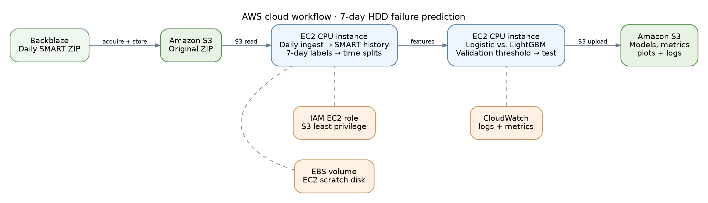

# Disk Failure Prediction in Cloud Data Centres Under Extreme Class Imbalance

**Project 7 · AWS + Python · Reproducible seven-day HDD failure warnings**

> **Status (15 October 2026):** University team completed an observed Amazon Linux EC2 run using real Backblaze Q1 2023 pilot training and Q2 2023 out-of-time evaluation; S3 outputs and CloudWatch screenshots were provided. The Q1 pilot has outcome-enriched sampling, while Q2 evaluation preserves the eligible selected-model population. The very high false-positive rates prevent production deployment. See **MSA_SUBMISSION_GUIDE.md** and actual CSV/JSON results.
> **GitHub:** Repository destination is https://github.com/mohammedhossam740-oss/cloud-project (the remote was empty when this package was prepared; upload the files before claiming publication).

## Goal

For a drive operating at the close of calendar day **t**, predict a confirmed failure during days **t+1 through t+7** from SMART counters observed by **t**. Optimize false alarms while achieving useful failure detection on real, severely imbalanced data.

## Architecture



AWS services: **S3** stores source/curated data, models and figures; **EC2** runs ingest, feature engineering and four ML experiments; **IAM** provides bucket-limited EC2 credentials; **CloudWatch** records EC2 CPU metrics and (with the optional agent) log files, memory and disk metrics. Costs depend on your region and use; the scripts do not provision resources.

## Official data and default selection

- Publisher: Backblaze, [official Drive Stats download](https://www.backblaze.com/cloud-storage/resources/hard-drive-test-data).
- Default archive: [2023 Q1](https://f001.backblazeb2.com/file/Backblaze-Hard-Drive-Data/data_Q1_2023.zip), approximately **819 MB ZIP / 7.53 GB uncompressed** according to the publisher.
- Defaults select HDD models **ST12000NM0008** and **ST14000NM001G**. Change `config/config.yaml` if the observed failures are insufficient in the selected period or across splits. The ZIP is **stream-read** one daily CSV at a time and filtered before concatenation; do not fully unzip it.
- This is an exploratory subset, not a representative sample of every HDD type. To compare other models, expand data and model selection only after checking feature semantics, failure counts and RAM.
- Backblaze data contains **one daily row per active drive** and occasional model-specific missing SMART attributes; raw SMART values are not always comparable across manufacturers.

## Main project files

| File | Responsibility |
|---|---|
| `src/data.py` | Ingest ZIP, conservative 7-day labeling, past-only history, chronological partitions. |
| `src/model.py` | Logistic baseline; weighted/unweighted LightGBM; feature ablation; model stratification. |
| `src/evaluation.py` | Validation-only threshold at recall target, operational test metrics and plots. |
| `src/cli.py` | Single command-line interface: download, prepare, eda, train, predict. |
| `src/eda.py` | Class, drive-model, correlation and SMART distribution plots on real data. |
| `aws/` | Ubuntu EC2 setup, IAM role/policy templates, CloudWatch agent config, cloud experiment shell script. |
| `diagrams/` | Mermaid + Graphviz source and exported PNG / SVG architecture diagram. |
| `tests/` | Unit tests and strictly synthetic execution fixture generator. |
| `report/` / `presentation/` | Academic report and presentation materials, **results pending cloud run**. |

## Local installation and checks (for development only)

Python 3.11+ recommended, Ubuntu or macOS; select 16 GiB RAM for practical quarter experiments.

```bash
python3 -m venv .venv
source .venv/bin/activate
python -m pip install -r requirements.txt
python -m pytest -q
```

**Network access** is needed for `download` and package installation. For a data-quality smoke check only:

```bash
python -m tests.make_smoke_data
python -m src.cli train --parquet data/processed/SMOKE_ONLY_NOT_BACKBLAZE.pkl
```

These tests are **not** evidence of failure prediction performance. Do not copy their numerical metrics into the university report.

## Reproducing real results on an AWS EC2 instance

### 1. Review AWS account and cost controls

For an AWS-account walkthrough (budget → bucket → role → EC2 → package transfer → experiment), see `aws/STEP_BY_STEP_AWS.md`. See `aws/cost_checklist.md`; verify current charges in the [AWS pricing calculator](https://calculator.aws/). **Explicitly authorize provisioning** of charged infrastructure within your own AWS account. A useful starting profile is a **t3.xlarge** Ubuntu 24.04 instance (4 vCPU, 16 GiB RAM) with ~30–50 GiB gp3 EBS, but availability and RAM requirements depend on selected drives/data. CPUs suffice; a GPU is not required. For large experiments, raise memory/volume size and estimate costs again.

### 2. Set up S3 bucket and IAM role

Using the AWS Console (in your chosen region):

1. Create a globally unique private S3 bucket and enable Block Public Access.
2. Copy `aws/iam_ec2_s3_policy.template.json` and substitute `REPLACE_WITH_BUCKET_NAME` with the exact bucket name. Create a custom IAM policy using it.
3. Create an IAM role trusted by **EC2** (trust-policy file `aws/iam_ec2_trust_policy.json`), attach the project S3 policy, and attach the role to your EC2 instance. For CloudWatch Agent logging, additionally attach the AWS-managed `CloudWatchAgentServerPolicy` or an equivalently restrictive logging/metrics policy.
4. Do not create or paste permanent AWS keys into your repository. The instance role supplies temporary credentials.
5. Configure instance security group to allow SSH only from a trusted IP, if using SSH; avoid public access to any other port. Use an authorized SSM workflow if configured.
6. Optional: create a budget and billing alert. Alerts do not automatically shut down an instance.

S3 layout after a real cloud run:

```text
s3://YOUR-BUCKET/disk-failure/
  raw/data_Q1_2023.zip
  processed/drive_features.parquet
  processed/dataset_summary.json
  models/*.joblib
  results/metrics/*.json and comparison.csv
  results/figures/*.png
  results/predictions/test_predictions.csv
  logs/cloud_experiment.log
  holdout_runs/ ... (when that experiment is feasible)
```

### 3. Execute processing and ML on EC2 — not the laptop

Clone or transfer the project onto the Ubuntu EC2 instance, enter the project folder, and run:

```bash
bash aws/setup_ubuntu_ec2.sh
export DISK_BUCKET="YOUR-UNIQUE-BUCKET"
export AWS_DEFAULT_REGION="YOUR-AWS-REGION"
bash aws/run_cloud_experiments.sh
```

The cloud script **downloads** Backblaze's real data on EC2, **uploads** the original archive to S3, **fetches it from S3**, performs cleaning, label creation, EDA, Logistic Regression and three LightGBM comparisons on EC2, and uploads curated Parquet, trained pipelines, metrics, figures and logs to S3.

Optional CloudWatch Agent: install Amazon CloudWatch Agent following the [official AWS instructions](https://docs.aws.amazon.com/AmazonCloudWatch/latest/monitoring/Install-CloudWatch-Agent.html), copy `aws/cloudwatch_agent.json` to your agent location and load its configuration. Set the `file_path` to the actual repository path if the project is not under `/home/ubuntu/disk-failure-prediction-cloud`. Without the agent, EC2's basic CloudWatch metrics can still be viewed, but the custom file logs/memory metrics do **not** appear automatically.

To review results after the run:

```bash
aws s3 ls "s3://$DISK_BUCKET/disk-failure/results/metrics/"
aws s3 cp "s3://$DISK_BUCKET/disk-failure/results/metrics/comparison.csv" -
```

Keep a screenshot or record of the running EC2 instance, S3 object timestamps, console log, and CloudWatch graph as cloud execution evidence. Note the EC2 instance type, region, run date and software versions in the report.

### 4. Stop resources / remove charges

Once results are safely copied from S3, stop or **terminate** EC2 as appropriate. Inspect and remove unattached EBS volumes, unneeded Elastic IPs and old S3 objects/log groups that can continue to incur charges. Verify in AWS Billing. **Stopping EC2 does not necessarily stop all EBS/storage charges.**

## CLI (real data)

```bash
python -m src.cli download
python -m src.cli prepare
python -m src.cli eda
python -m src.cli train
python -m src.cli train --holdout-model ST14000NM001G
python -m src.cli predict --input-json sample_smart_row.json
```

The unseen-model evaluation writes separately under `holdout_runs/ST14000NM001G/`, never overwriting standard-run artifacts. A test split with no failures is reported as **not evaluable**; add longer history rather than making up numbers.

## Label design and leakage protections

1. Sort each disk by (`serial_number`, `date`); prefer the failure marker when duplicate drive/day records exist.
2. Compute **historical features on raw daily observations first** (never use future readings).
3. Assign `target=1` if the drive has a confirmed failure in `(t,t+7]`.
4. Assign `target=0` only if **all next seven daily observations exist** with no earlier recorded failure. Do not infer failure from disappearance and do not call a censored drive healthy.
5. Exclude failure-day records and all observations on/after recorded failure from prediction training.
6. Split predictions chronologically with a **seven-day embargo** between partitions so no training label reaches into validation/test. Some drive IDs remain in multiple partitions; this measures future-period forecasting on a known fleet, not independent-new-drive generalization.
7. Fit imputation and scaling **on training only**; select warning threshold **on validation only** for a requested recall (default 80%); measure it on untouched test rows. The observed test recall may be less than 80%.
8. Optional model holdout trains on a model-disjoint source population and tests on the unseen HDD model.

**Important limitations:** A single quarter may contain too few *distinct failing drives* for reliable generalization conclusions; repeated positive days for one drive are correlated. Document both drive-day and distinct-drive recall and consider multi-quarter data and clustered confidence intervals in extended work. Model-specific SMART raw counter meanings can differ. If hardware is limited, `max_training_rows` samples healthy TRAIN rows but leaves validation and test at the natural prevalence; the training distribution is modified and results require caution.

## Baseline and improvement

- **Baseline:** median-imputed, max-abs-scaled and one-hot-encoded Logistic Regression, class balanced.
- **Proposed:** LightGBM with SMART 3-day deltas/rolling means + class cost weight + validation-selected threshold.
- **Ablation:** static SMART LightGBM / temporal unweighted LightGBM / temporal weighted LightGBM.
- **Metrics:** precision, recall, F1, average precision (PR-AUC summary), ROC-AUC, FPR = FP/(FP+TN), false alerts per 1,000 evaluated drive-days = FP/N × 1,000, confusion matrices, drive-event recall and elapsed training time.
- **Target-recall constraint:** pick the highest available **validation** score threshold whose recall is >=0.80. This is an operational trade-off, **not a guarantee** about the held-out test set.

## Reproducibility and evidence to include in the final report

Fill these with actual output from your cloud run:

| Evidence | Where |
|---|---|
| Selected raw dataset, failure counts and missingness | `data/processed/dataset_summary.json` and matching S3 key |
| Split ranges and actual class counts | `results/metrics/run_metadata.json` |
| Baseline / temporal / weighted scores | `results/metrics/comparison.csv` |
| Per-model test metrics | `results/metrics/*.json` |
| Confusion matrices / PR and ROC plots / EDA | `results/figures/` |
| Saved models and threshold | `models/*.joblib` |
| Cloud execution evidence | `cloud_experiment.log`, S3 and EC2/CloudWatch console |

**Submission gate:** Do not submit the drafted results table until real data was processed and the exact results have been incorporated into the DOCX/PDF/slides. These deliverables are accurate *project implementation + pending experimental reporting*, not a claim that mandatory AWS runs have already happened.

## References and data credit

Cite Backblaze in any presentation/report: [Official Backblaze Drive Stats](https://www.backblaze.com/cloud-storage/resources/hard-drive-test-data). Verified literature sources are included in the academic report. Backblaze asks that its data be credited and not resold as a standalone dataset.

## Authorship and collaboration

Add team members / student IDs and a GitHub repository URL only after publishing the project. Keep AWS account identifiers and secrets out of version control.
